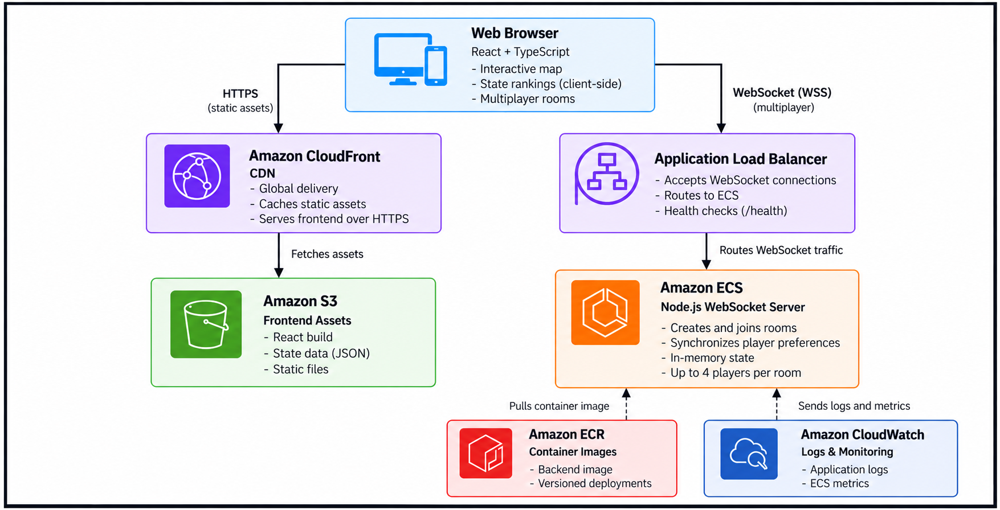

# StateMatch

An interactive U.S. state ranking and real-time multiplayer comparison app built with React, TypeScript, Node.js, WebSockets, and AWS.

[View Live App](https://d2npxd8mcwhbp4.cloudfront.net/)

## Demo

https://github.com/user-attachments/assets/7c2295cf-100c-4091-9532-63d0f1d66065

## About

StateMatch helps users discover which U.S. states best match their priorities. It ranks all 50 states across 13 factors, including affordability, climate, safety, and lifestyle, with an interactive map and detailed score breakdowns. Multiplayer rooms let up to four people combine preferences and explore their best shared matches in real time.

State data and weighted ranking calculations run entirely in the browser, without requiring backend requests. Multiplayer uses a Node.js WebSocket server hosted on Amazon ECS behind an Application Load Balancer. The React frontend is stored in S3 and delivered through CloudFront.

## AWS Architecture

## Engineering Decisions & Tradeoffs

### Separating Static and Stateful Workloads
Solo rankings run entirely in the browser, while only multiplayer requires backend coordination. This keeps the core application responsive and reduces server workload without sacrificing real-time collaboration.

### Cost vs. Availability
S3 and CloudFront serve the frontend independently of ECS, allowing multiplayer compute capacity to be managed separately. Reducing idle compute costs comes at the expense of potential startup delays and additional infrastructure complexity.

### Real-Time Synchronization
WebSockets provide immediate updates without repeated HTTP polling. The server synchronizes player preferences, while each client calculates rankings locally, reducing backend computation and network traffic.

### Simplicity vs. Scalability
Rooms are stored in memory rather than a database, keeping updates fast and infrastructure simple. Scaling across multiple ECS tasks would require shared state and cross-instance messaging to keep players in the same room synchronized. This was considered but not implemented due to the current scale.

### Reliability and Session Management
The backend validates messages, limits request rates, and handles disconnects, room cleanup, and host reassignment. Multiplayer sessions are temporary rather than persisted, favoring simplicity over recovery after server restarts.
